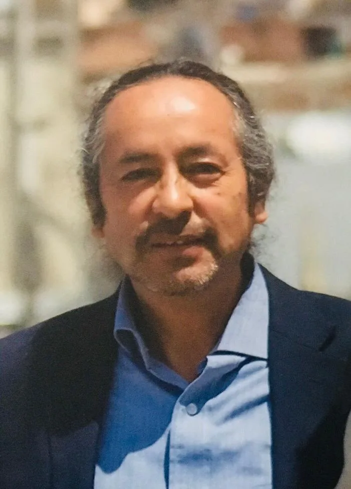
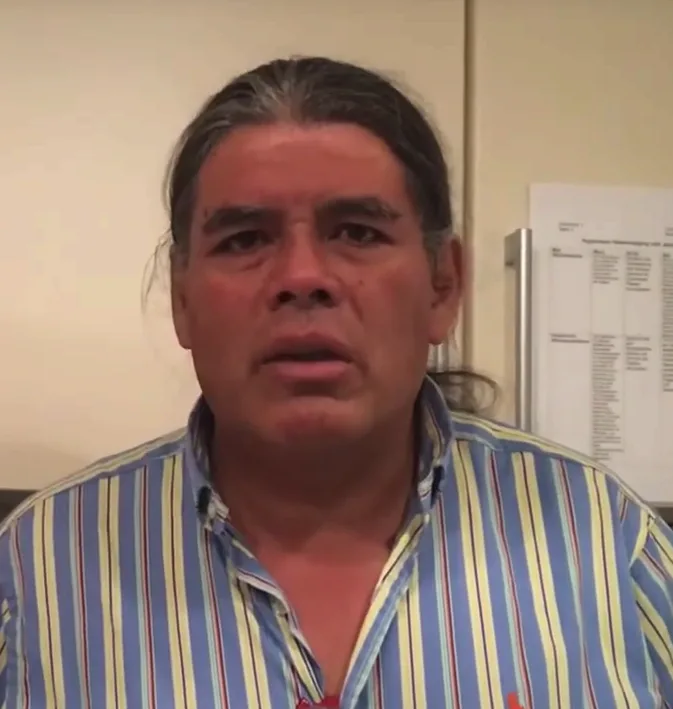

## Conoce a nuestros profesionales

Nuestro equipo, apasionado y dedicado, reúne una amplia gama de habilidades y experiencia para ofrecer resultados excepcionales. Desde visionarios creativos hasta estrategas meticulosos, trabajamos en estrecha colaboración para cumplir y superar las expectativas de nuestros clientes.

Dr. HC Francisco Mena Flores, Ecuador

Director del Centro Dr. Isaac Goiz Durán, Quito Ecuador

Dirección: Pineda N11 -121
Celular y WhatsApp: +593 99 864 9759
Correo: centrodrgoiz@gmail.com

Carolina Orozco García, Ecuador

Fisioterapeuta

Rehabilitadora física del Centro Dr. Isaac Goiz Durán, Quito Ecuador
Correo: carolina-lnd@hotmail.com

Norma Torres, Estados Unidos

Terapeuta

Coordinadora, Alabama Estados Unidos
Dirección: 1465 Summit St
Rusellville Alabama 35653
Correo: gabrielatorres5555@gmail.con

Vivianne Bossy Fischer, Chile

Terapeuta

Coordinadora del Centro Dr. Isaac Goiz Durán, Santiago de Chile
Correo: vivibossy@gmail.com

Coco Vizcarra, Alemania.

Terapeuta

Coordinador, Berlín Alemania
Correo: service@inkareisen.de
