### Doctor HC Francisco Mena Flores
Instructor en Biomagnetismo, Bioenergética y Constelaciones Familiares

**DATOS PERSONALES:**

### FRANCISCO MENA FLORES

Fundador y Director del Centro de Biomagnetismo Médico ¨Dr. Isaac Goiz Durán – Santiago de Chile, 2010”

### TITULO OBTENIDO

Tecnólogo Médico Radiólogo, Universidad Central del Ecuador, 1986.

Doctorado Honoris Causa, Universidad Carlos Mariátegui Facultad de Medicina Arequipa, Perú 2011.

Master en Biomagnetismo, otorgado por la Health Sciences Awards, SISDET, y Universidad de Puebla, México 2024.

Doctorado Honoris Causa, Universidad Autónoma de Chiriqui – UNACHI, Panamá 2025.

### OBRAS PUBLICADAS

Clínica, ubicación anatómica y energética de los pares biomagnéticos. «Sistema del Dr. Isaac Goiz Durán.»

### CURSOS

Biomagnetismo, primera promoción Guayaquil – Ecuador.

Primera Promoción de Biomagnetismo avalado por el Ministerio de Salud, Ecuador 2002.

Diplomado en Bioenergética, Primera promoción en la Universidad Chapingo, México DF, 2004.

Constelador Familiar, formado por Bert Hellinger en Argentina, México y Ecuador del 2007 al 2009.

Instructor en Biomagnetismo y Bioenergética a no videntes en Chile y Argentina 2009 al 2019.

Instructor de Biomagnetismo y Bioenergética a hermanos indígenas de Perú, Bolivia, Chile y Paraguay del 2010 al 2020.

Instructor del Centro de Biomagnetismo Médico Dr. Isaac Goiz Durán – Chile, 2010-2025.

Instructor de Biomagnetismo en la Universidad Tecnológica Federico Santamaría, Valparaíso, Chile 2011.

Dicto cursos de Biomagnetismo y Bioenergética en las universidades Federico Santa María de Valparaíso-Chile y  UDLA de Santiago de Chile 2011.

Instructor de Biomagnetismo en la UDLA, Santiago de Chile 2013-2014.

Instructor en Bolivia, autorizado por el Ministerio de Salud y el Hospital San Juan de Dios, Bolivia 2016.

Instructor de Biomagnetismo en la Universidad Técnica de Oruro, Bolivia 2018.

Instructor de Biomagnetismo y Bioenergética en EE.UU, Centroamérica, Sudamérica y Europa 2009-2025.

Instructor de Biomagnetismo y Bioenergética en Universidad Católica de Temuco, Temuco – Chile, 2025.

Instructor de Biomagnetismo y Bioenergética, Asunción – Paraguay, 2026.

### REPRESENTACIONES

Cofundador del Colegio de Biomagnetismo de Chile 2006.

Cofundador y Primer Presidente de la Sociedad de  Biomagnetismo de Chile 2009.

Fundador y Director del Centro de Biomagnetismo Médico Dr. Isaac Goiz Durán, Santiago de Chile, 2010.

Cofundador del Colegio de Biomagnetismo de Bolivia 2016.

Representante Internacional de Bioenergética y Ciencias Aplicadas SIBCA AC México, 2022.

### EXPERIENCIA

Pionero de Biomagnetismo en Suiza, Luxemburgo, Chile, Brasil, Argentina, Bolivia, Uruguay, Paraguay y Nicaragua.

Discípulo y asistente del Dr. Isaac Goiz Durán del 2002-2015.

Pionero en la formación de Biomagnetismo y Bioenergética a los pueblos indígenas de Ecuador, Perú, Chile, Bolivia y Paraguay 2008-2023.

Creador del Método de Enseñanza de Biomagnetismo para no videntes en Chile y Argentina, 2009.

Realizó el primer programa piloto de Biomagnetismo en el Hospital San Juan de Dios de Oruro, logrando el alta de 122 pacientes con un 100% de efectividad en 4 días, Bolivia 2016.

Expositor y Socio Activo de la Organización Científica en la Red Iberoamericana de Bioelectromagnetismo, León, GTO, México 2021 y 2022.

Expositor 18 edición Health Scientes Awards Panamá 2025.

### PRUEBA EN ALEMANIA

En Ulm Alemania le hacen una prueba con el Sistema Suizo-Alemán de última generación, Global Diagnostic System, que detecta microorganismos,  demostró  la eficacia del Biomagnetismo en el diagnóstico y eliminación de microorganismos y toxinas.

### RECONOCIMIENTOS OBTENIDOS

Doctorado Honoris Causa,  Universidad Carlos Mariátegui Facultad de Medicina Arequipa – Perú.

Reconocimiento del Ministerio de Salud del Ecuador en el 2015.

Reconocimiento por La Asamblea Constituyente, Bolivia 2016. Mención obtenida por la atención dada a pacientes del Hospital San Juan de Dios de Oruro y haber logrado el alta al 100% de pacientes (128) en 4 días.

Realizó el primer programa piloto de Biomagnetismo en el Hospital San Juan de Dios de Oruro, logrando el alta de 128 pacientes con un 100% de efectividad en 4 días. Bolivia, 2016.

Reconocimiento del Consulado General del Ecuador en Santiago de Chile, 2017.

Reconocimiento de la Alcaldía de Santiago de Chile 2017.

Miembro de la Academia Mundial de las Ciencias de la Salud en los Health Sciences Awards, SIISDET Colombia, 2023.

Doctorado Honoris Causa, Miembro de la Academia Mundial de las Ciencias de la Salud en los Health Sciences Awards, SIISDET Panamá, 2025.

### PACIENTES TRATADOS EN:

Ecuador, Chile, Perú, Bolivia, Brasil, Uruguay, Paraguay, Colombia, Panamá, Argentina, Guatemala, Estados Unidos, Alemania, Luxemburgo, Suiza y España con un 90% de resultados positivos.

  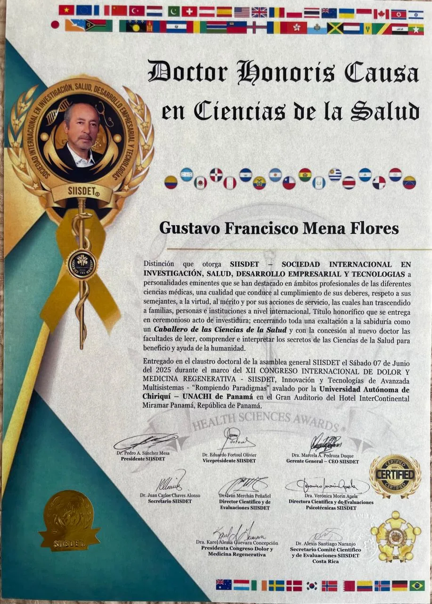

  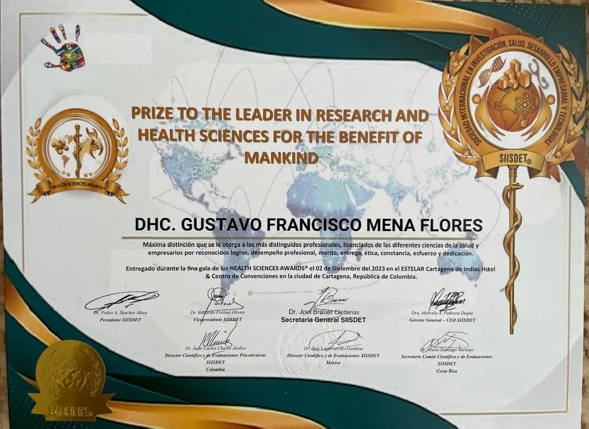

  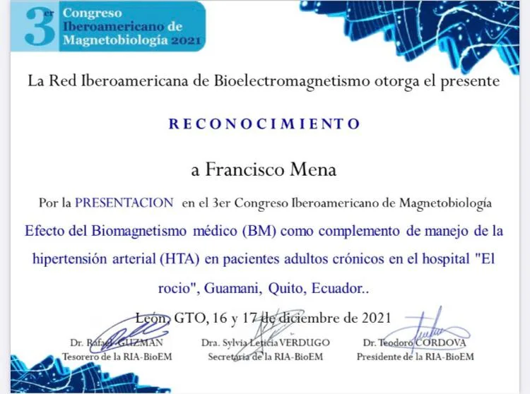

  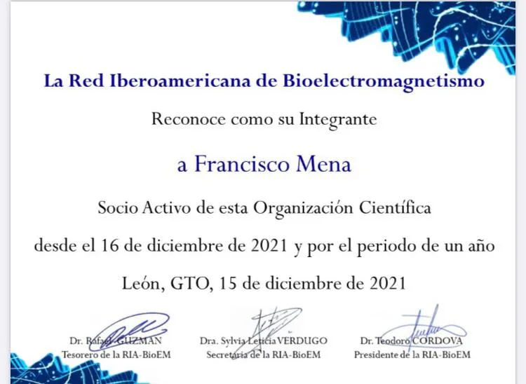

  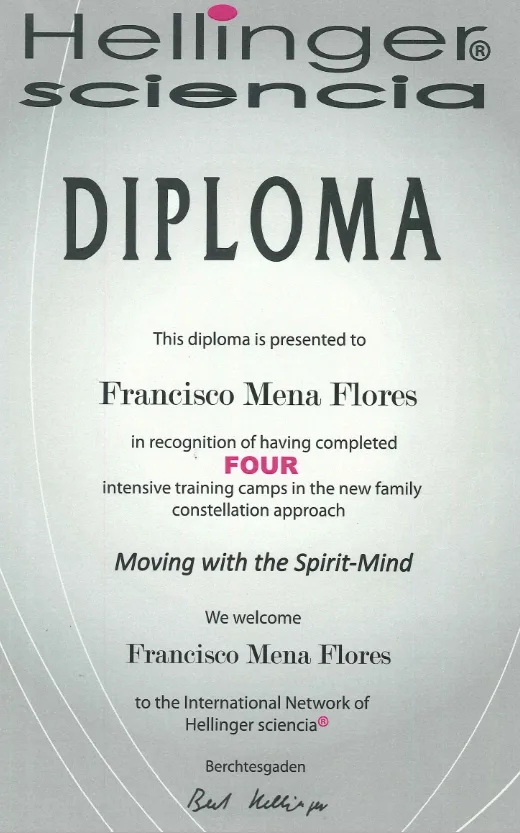

  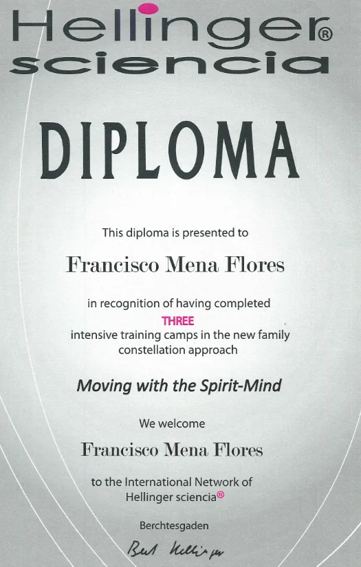

  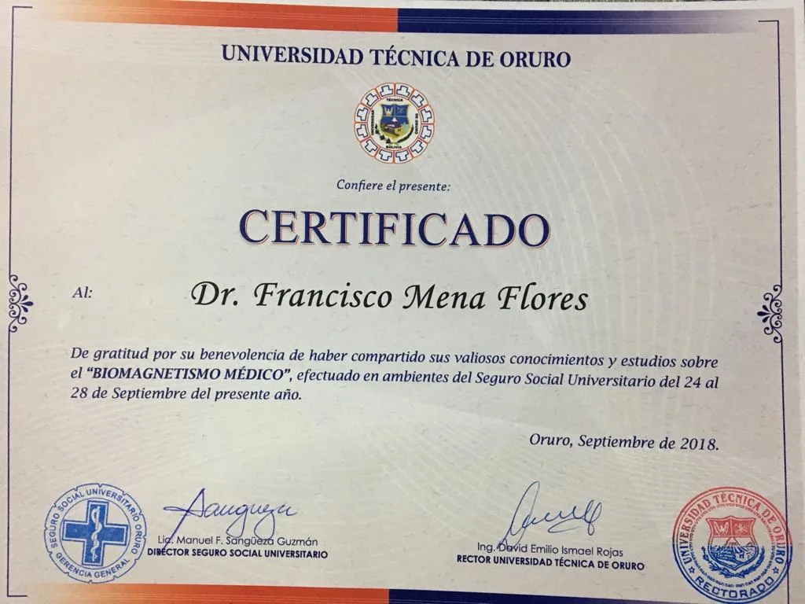

  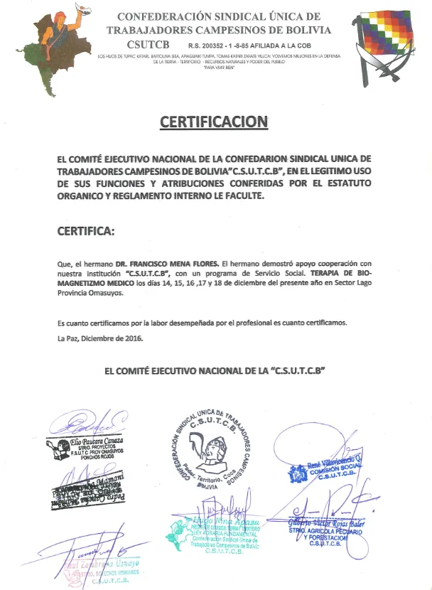

  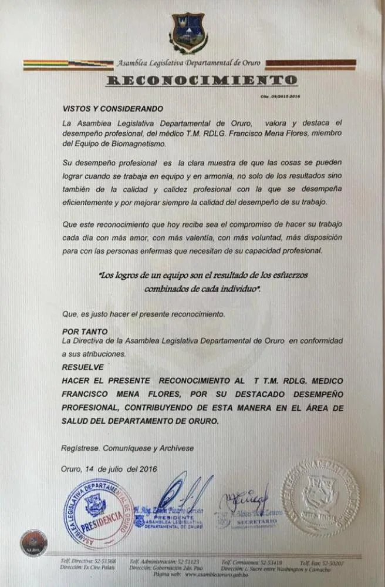

  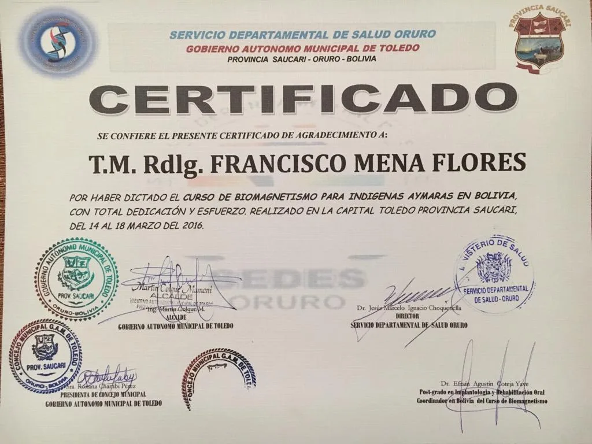

  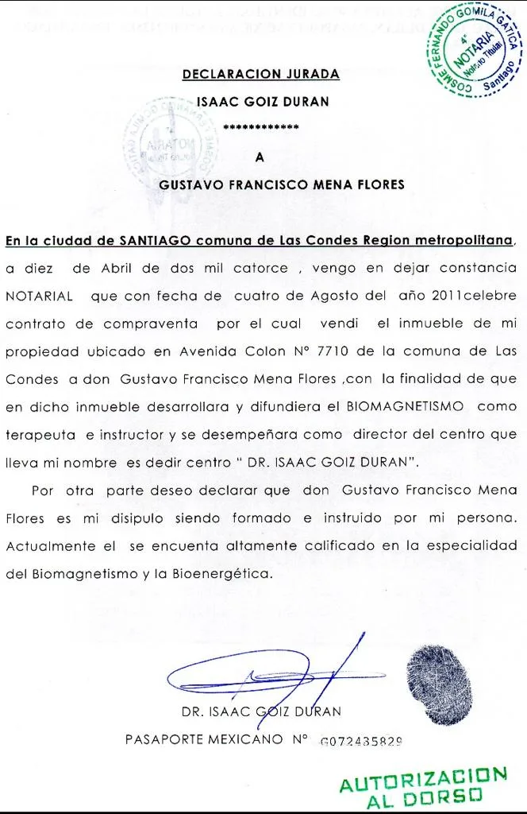

  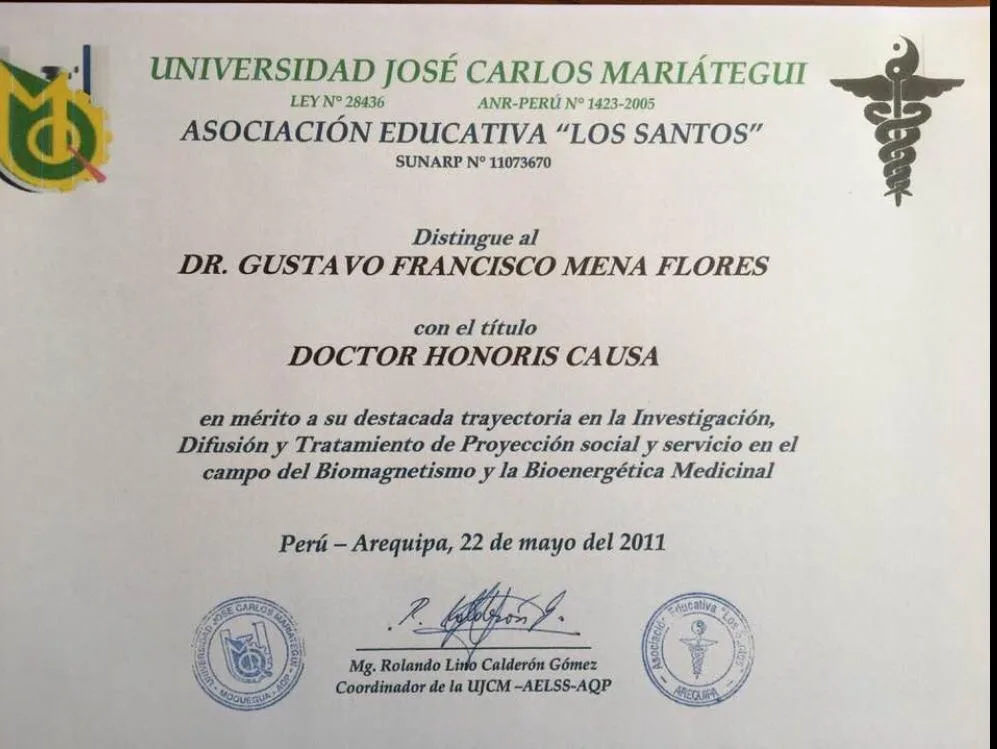

  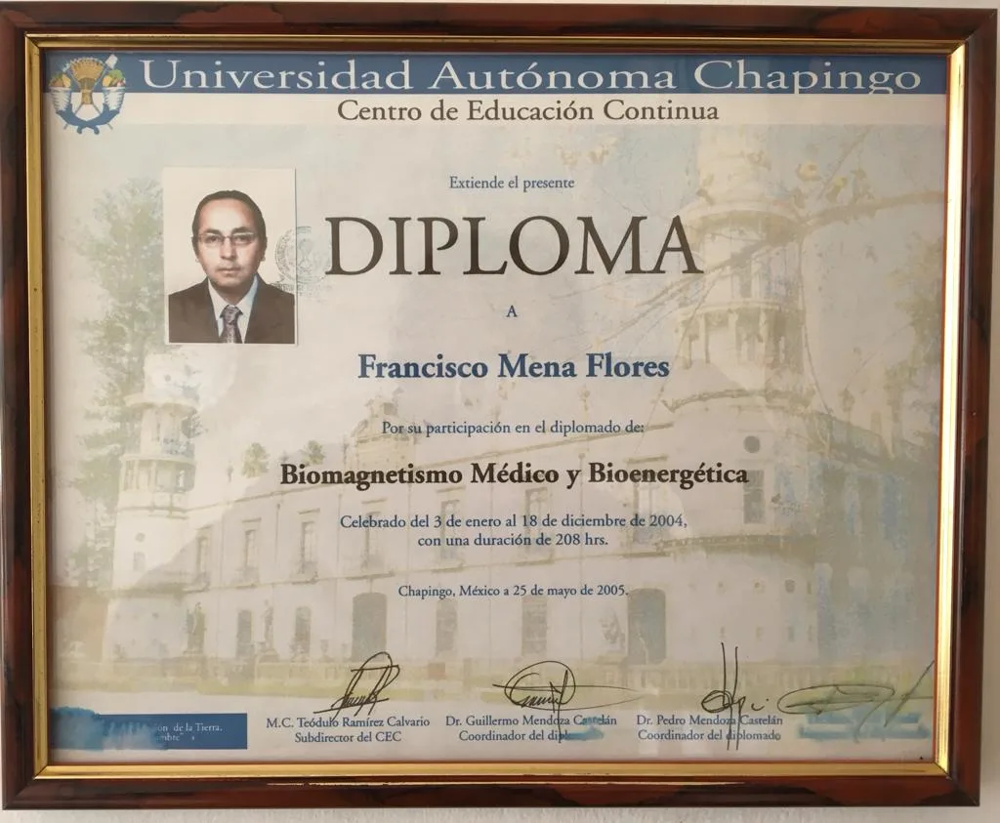

  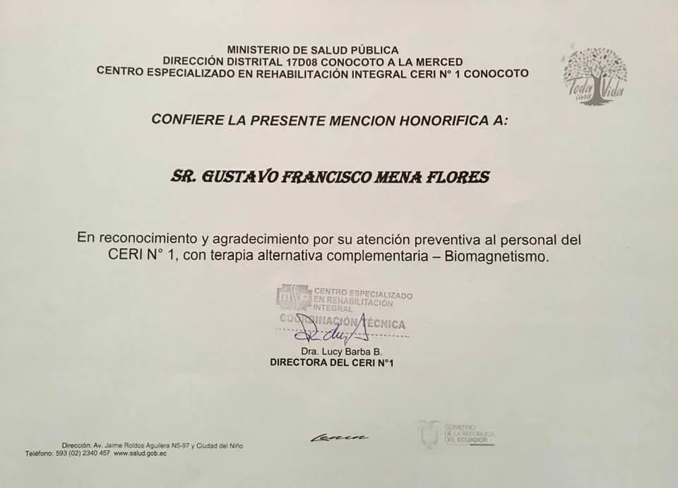
