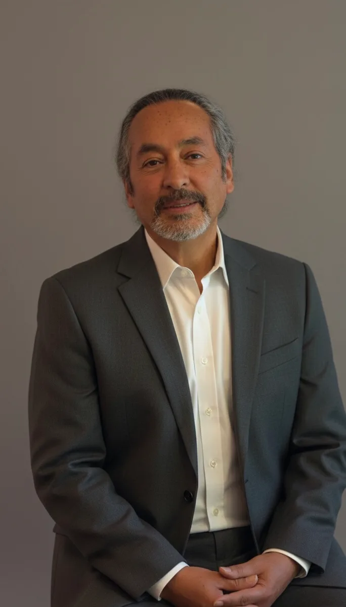
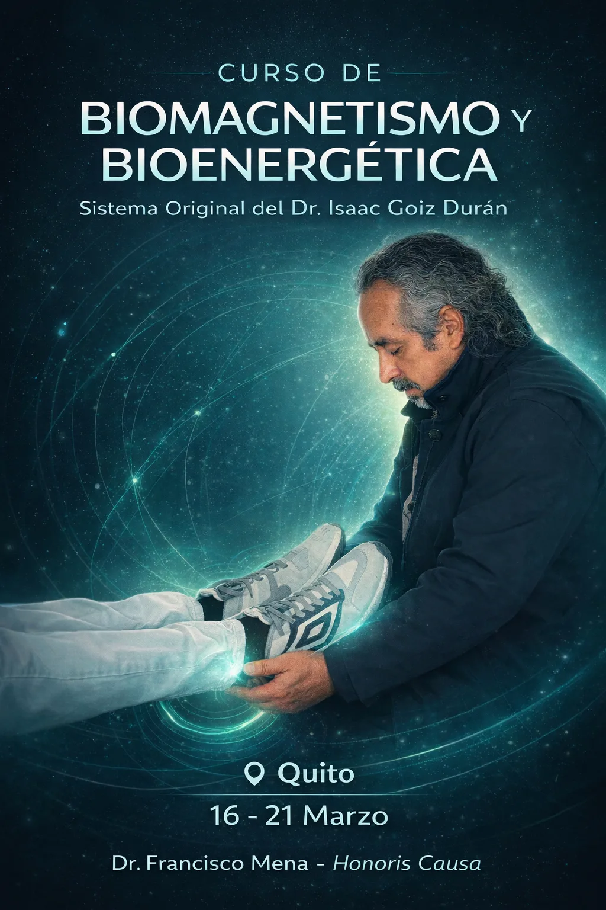

# Centro de Biomagnetismo Médico

Sistema terapéutico descubierto por el Dr. Isaac Goiz Durán, el 10 de octubre de 1988. “…Biomagnetismo Médico estudia, detecta, clasifica, mide y corrige las alteraciones fundamentales del pH (potencial de hidrógeno) de los órganos vivos y específicamente de los organismos humanos…”

[

Francisco Mena

](/francisco-mena/)

## IX congreso internacional de dolor y medicina regenerativa

Evento científico de alto nivel organizado por la Sociedad Internacional en Investigación, Salud, Desarrollo Empresarial y Tecnologías (SIISDET). Se llevó a cabo en 2023, marcando un hito en la serie de congresos anuales que esta organización realiza para difundir avances médicos.

## Francisco Mena Flores

El Dr. HC Francisco Mena no es solo un terapeuta, es un **institucionalizador de la técnica** del biomagnetismo y de bioenergética. Su enfoque es formal y académico dentro del mundo de la medicina complementaria. Su reciente Master en 2024 y el Honoris Causa en Panamá 2025 demuestran que, a pesar de sus décadas de experiencia, sigue activo en la vanguardia de la **Medicina Regenerativa**.

# Terapia con el par biomagnético

Detecta los microorganismos como virus, hongos, bacterias, parásitos, disfunciones y corrige sus alteraciones.

Trata toda clase de patologías, no causa efectos colaterales y se complementa con todo tipo de medicina.

## Nuestros servicios

Terapias y cursos, presenciales y a distancia.

### Cursos de biomagnetismo y bioenergética

Los cursos son dictados por el Dr. HC Francisco Mena Flores, Pionero en Chile del Biomagnetismo e instructor autorizado.

### Terapia presencial

Brindamos atención personalizada de 30 minutos, aplicando imanes con precisión para equilibrar el pH y restaurar tu bienestar.

### Terapia a distancia

Realizamos bioenergética (tratamiento a distancia) terapias via on-line por zoom, contamos con las herramientas adecuadas.

### Constelaciones familiares

Técnica desarrollada por el doctor Bert Hellinger.

## **Gira Internacional de Formación 2026: Biomagnetismo y Bioenergética**.

Únete a los entrenamientos certificados impartidos por el **Dr. HC Francisco Mena**, aprenderás a restaurar el equilibrio bioeléctrico del cuerpo y a neutralizar patógenos mediante imanes y técnicas avanzadas de bioenergética.

-   3 de marzo de Asunción – Paraguay.
-   16 – 21 de marzo Quito – Ecuador.

  

  
